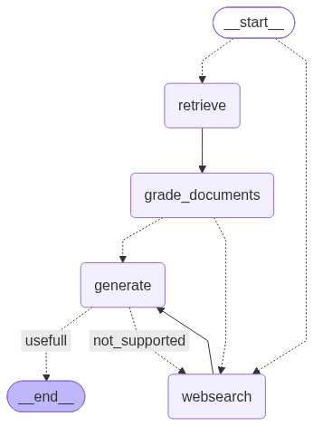

# Agentic RAG (LangGraph)

A self-correcting Retrieval-Augmented Generation pipeline built as a LangGraph `StateGraph`. It routes each question to a local vector store or to the web, grades what it retrieves, and checks its own answer for hallucinations and usefulness before returning it.



## How it works

1. **Route** (`chains/router.py`): an LLM picks `vectorstore` or `websearch` for the question. If the router fails, it falls back to the vector store.
2. **Retrieve** (`nodes/retrieve.py`): fetches chunks from a Chroma store built from three Lilian Weng blog posts (agents, prompt engineering, adversarial attacks on LLMs).
3. **Grade documents** (`nodes/grade_documents.py`): an LLM grader drops irrelevant chunks. If any chunk is dropped, a web-search flag is set.
4. **Web search** (`nodes/web_search.py`): Tavily results are added to the context.
5. **Generate** (`nodes/generate.py`): answers from the context in at most three sentences.
6. **Grade the answer** (`graph.py`): a hallucination grader and an answer-usefulness grader run on the output. A bad answer goes back to web search. The loop is capped at `MAX_WEB_RETRIES = 1`, so it cannot run forever.

## Project layout

```
main.py             CLI entry point: asks a question, runs the graph, saves JSON + log
graph.py            StateGraph wiring, conditional routers, retry cap
state.py            GraphState TypedDict
consts.py           Node-name constants
ingestion.py        Scrapes, chunks and embeds the source pages into Chroma (runs once)
imports.py          Single import page for all stdlib/third-party names (heavy libs lazy)
logging_config.py   Mirrors terminal output into logs/run_<timestamp>.log
utils.py            format_docs helper
nodes/              Graph nodes: retrieve, grade_documents, web_search, generate
chains/             LLM chains: router, retrieval/hallucination/answer graders, generation
chains/tests/       Offline tests (LLM is mocked)
```

## Setup

Requires Python 3.11+ (developed on 3.13).

```bash
git clone https://github.com/siddhant-debug/agentic-rag.git
cd agentic-rag
python -m venv .venv && source .venv/bin/activate
pip install -r requirements.txt
cp .env.example .env   # then add your keys
```

| Variable | Purpose |
|---|---|
| `NVIDIA_API` | NVIDIA NIM key for the chat model (`openai/gpt-oss-20b`) and embeddings (`nvidia/nemotron-3-embed-1b`) |
| `TAVILY_API_KEY` | Tavily web search |
| `LANGSMITH_*` | Optional tracing |

## Usage

```bash
python main.py
```

Type a question, or press Enter to use the default ("What is agent memory?"). The first run scrapes and embeds the three source pages into `.chroma/`, which takes a while. Later runs reuse it.

Each run prints the answer and its sources, and writes two local files (both git-ignored):

- `outputs/result_<timestamp>.json`: full final graph state
- `logs/run_<timestamp>.log`: everything shown in the terminal

`graph.py` also tries to render `graph.png` into the current directory. It uses mermaid.ink, so it needs network access and fails quietly without it.

## Tests

```bash
cd chains/tests
python -m pytest -q
```

The tests run offline with a mocked LLM and need no API keys.

## Notes

- The free NVIDIA NIM tier can queue requests under load, so the LLM calls use a 60 s timeout with up to 4 retries and exponential backoff.
- Keep the `.chroma` store out of iCloud/Dropbox-synced folders. Evicted files can make Chroma hang.
